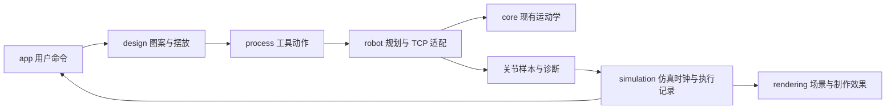

# RobotCraft Studio 产品与架构设计

创建日期：2026-10-19；更新：2026-10-20。状态：S0 初始化与算法迁移、S1 笔绘及 S3 奶油裱花默认演示已实现；S4 尚未实现。实现与验证记录见[笔绘计划](../plans/2026-10-19-pen-simulation.md)和[双工艺记录](../plans/2026-10-20-two-process-demo.md)。

## 1. 已确认的目标

用户希望在原课堂 demo 基础上另建同级仓库，开发纯软件仿真。机械臂末端可换笔或裱花嘴，用于写字绘图和奶油裱花。初始化阶段只迁移必要结构与算法；当前已落实双工艺默认演示。

下一版产品主流程：左侧选择工艺 → 选择预设图案 → 使用固定默认参数自动规划 → 播放制作 → 查看结果。图案导入、大小与位置调整留到后续创作阶段。

课堂演示应让观众看清“图案如何变成工具动作，以及机械臂怎样执行”，并能暂停、调速、重置、重复比较。

## 2. 本次工程选择

以下是开发者根据当前项目做出的选择，用户可在功能实施前调整：

- 暂定名称 RobotCraft Studio，同级目录 `RobotCraft-Studio`，独立本地 Git 仓库。
- 沿用 TypeScript + Vite + Three.js + Vitest，初期 UI 使用原生 DOM/CSS；计算与渲染分开，不把全部逻辑放回 `main.ts`。
- 初期沿用课程八自由度机械臂，包括第 3 关节移动副，先保留数学回归基线。
- 当前统一提供笔绘、奶油裱花两种可选工艺，整体验收需两种工艺全部可用。
- 每种工艺使用一套经过验证的固定默认参数，不开放参数调整；笔绘纸面高度 0 mm 与笔长 24 mm 继续作为基线。原 S1 的参数控件已移除。
- 新产品领域使用毫米、秒和弧度；旧算法的 `u` 暂按 `1 u = 10 mm` 映射。该比例是虚拟场景尺度约定，不代表原教材的物理尺寸。
- 项目保存留到 S4，采用用户主动导入/导出的带版本号 JSON 文件。下一版双工艺演示不包含保存功能，不引入账户、服务器或数据库。

## 3. 仿真范围

| 工艺 | 计划显示的动作与结果 | 本轮状态 | 明确边界 |
| --- | --- | --- | --- |
| 笔绘 | 接近、落笔、沿路径绘制、抬笔、转移；平面笔迹 | S1 已实现 | 首版采用预设多笔画路径；任意中文的笔顺生成不在首版内 |
| 裱花 | 喷嘴移动、出料启停、抬起；沿路径生成有宽度的几何条带 | S3 默认演示已实现 | 几何挤出效果，不做奶油流变、重力塌陷或真实工艺质量预测 |

共用工具装配关系与轨迹播放。工具更换同时更新 TCP 偏置、外观和工艺参数，不以替换网格模型代替工具逻辑。

### 3.1 已确认并实现：更换末端工具制作图案

2026-10-20 用户确认并实施：保留同一套八自由度机械臂，在左侧控制台选择笔绘或蛋糕奶油裱花，立即切换末端工具、对应工件及默认配置。不展示自动取放工具的动画。

两种工艺均复用 ROBOT 字样、四笔汉字「中」、连续花形，用户可选择工艺和图案。每种工艺只有一套固定默认配置，图案大小与位置、颜色、加工速度、工具和工件尺寸及下表中的工艺参数均由配置维护，界面不提供调整入口。任意文字、SVG 导入、自由绘图和参数编辑留到后续阶段。

| 末端工具 | 工件与图案转换 | 固定配置项（不开放调整） | 动作与可见结果 |
| --- | --- | --- | --- |
| 绘图笔 | 纸面；路径保留笔画边界 | 笔迹颜色、绘制速度 | 落笔、绘制、抬笔；显示实际笔尖笔迹 |
| 圆口裱花嘴 | 圆形蛋糕顶面；将图案路径放置在蛋糕局部平面内 | 喷嘴口径、奶油颜色、移动速度、单位路径出料量、喷嘴离面高度、抬起高度 | 接近、开启出料、沿路径挤出、关闭出料、抬起、转移；生成单层奶油条带图案 |

裱花首版不包含花瓣纹理、多层堆叠或蛋糕侧面裱花。

默认值由开发时的规划验证确定，完整配置、六种组合的规划误差与间隙、实际制作结果检查见[双工艺记录](../plans/2026-10-20-two-process-demo.md)。同一套工艺配置覆盖三个预设，用户无需调参即可演示。后续如修改默认值，须重新验证全部组合；若有预设失败，应修正默认配置或实现，不能跳过该组合或要求用户调参。

工具配置保存工具标识、法兰到 TCP 的变换及几何包络；工件配置保存尺寸与位姿。纸面 0 mm、笔长 24 mm 仍是笔绘专用配置，喷嘴出口和蛋糕顶面使用自身配置。工艺层生成带工具状态的动作，机器人层统一规划，仿真层通过 FK 记录实际 TCP；笔迹和奶油几何均消费同一份执行记录。

切换工艺时停止当前播放、清空制作结果并作废旧规划，保留当前图案选择，载入对应工具、工件及固定默认配置后重新规划；切换图案也清空结果并重新规划。旧 Worker 结果必须被丢弃，规划完成前不能开始制作。尚未实现的工艺不得进入播放。裱花按蛋糕工件几何检查间隙，不能直接沿用纸面高度或宣称已有通用碰撞检测。

S3 验收关注喷嘴出口位置、奶油颜色与宽度、断笔间关闭出料、暂停和重播不重复堆料。两种工艺均应验证相同仿真时间下结果一致，以及更换工具后旧任务不能继续执行。

蛋糕奶油裱花采用几何挤出，不模拟接触力、奶油流变或塌陷，不增加硬件通信、后端或物理引擎。

### 3.2 当前笔绘的几何检查基线

笔绘规划增加画板局部几何检查：连杆/关节统一采用半径 4.4 mm 的保守包络，并额外预留 2 mm，检查关节样本及段内 1/4、1/2、3/4 插值姿态。渲染与校验共用画板尺寸；不满足间隙的候选轨迹会被舍弃。此检查不包含自碰撞、其他障碍物或完整连续碰撞检测，界面标注“画板几何检查 · 未检查其他碰撞”。

## 4. 技术路线与取舍

| 领域 | 采用方案 | 理由 |
| --- | --- | --- |
| 开发与构建 | TypeScript 严格模式、Vite、npm lockfile | 沿用现有工具，减少迁移变量，输出静态站点 |
| 三维与数学 | Three.js WebGLRenderer，沿用 Vector3 / Quaternion / Matrix4 | 当前算法已使用这些数学类型，无需同时重写数学库 |
| 界面 | 原生 TypeScript / DOM / CSS，按功能模块组织 | 当前是单一工作站；先明确状态管理和渲染生命周期，暂不增加 UI 框架 |
| 规划计算 | 纯计算函数；进入长路径规划阶段使用 Web Worker | 避免大量逆解阻塞交互；消息携带任务版本和普通数组 |
| 测试 | Vitest 计算与状态测试，浏览器人工交互验证 | 分开验证数学正确性、播放行为与可见结果 |
| 部署 | 本地开发与生产构建预览；已部署 GitHub Pages | 静态站点，`main` 推送触发构建、测试与部署；README 提供本地演示流程 |

此阶段不引入 ROS、Python 后端、物理引擎、硬件协议或通用插件系统。遇到实际功能需求后再单独评估，而非预先堆叠基础设施。

## 5. 模块与依赖

S0 迁移时的目录（保留作为来源记录）：

```text
src/
  main.ts                  # 仅入口与样式导入
  style.css                # 最小占位样式
  core/
    robot.ts               # 原样迁移的课程机械臂算法
    trajectory.ts          # 原样迁移的轨迹算法与课程路径
tests/
  kinematics.test.ts       # 原有 7 项测试，仅调整 import 路径
```

以下为模块分工。已创建 app、design、process、robot、simulation、rendering 并实现两种工艺；project 模块尚未实现：

| 模块 | 对外职责 | 不负责的内容 |
| --- | --- | --- |
| `app` | 用户命令、项目状态、选择、规划任务版本、界面同步 | 直接实现 IK 或 Three.js 绘制细节 |
| `design` | 图案路径、尺寸、位置变换、后续受限 SVG 导入 | 生成关节角或制作效果 |
| `process` | 根据笔绘/裱花工艺生成工具动作与参数 | 直接操纵机械臂网格 |
| `robot` | 工具坐标换算、旧单位适配、调用 `core` 规划关节样本、返回误差诊断 | DOM、相机与播放时间 |
| `simulation` | 仿真时钟、执行进度、从关节样本生成实际 TCP 执行记录 | 用户输入与场景渲染 |
| `rendering` | 消费执行记录绘制机械臂、工具、笔迹/挤出条带 | 独立重算另一条用于显示的运动路径 |
| `project` | 项目 JSON 编解码、版本与输入校验 | 保存运行中的 Three.js 对象或派生网格 |



`core` 暂时仍包含课程预设和固定八自由度参数，它是保留的迁移基线，并非已经抽象完成的通用机器人模块。后续按需求提取预设与机器人参数时，先通过测试比较数值结果。

## 6. 数据与坐标约定

- 基座世界坐标为右手系，Z 向上；新场景使用 `1 场景单位 = 1 mm`，相机 up 向量为 Z。旧 UI 的缩放/轴映射不迁移。
- 图案在工件局部 XY 平面上定义，工件位姿负责变换到基座世界坐标。
- `T_base_tcp = T_base_flange × T_flange_tcp`。规划时先求所需法兰位姿，再转换长度到旧算法的 `u`；执行记录用 FK 和相同 TCP 偏置还原实际工具尖端。
- 旋转输入、速度与误差内部采用弧度；界面可以转换成角度显示。四元数序列化顺序为 `[x, y, z, w]`。
- 转动关节变量为弧度；旧模型移动关节变量为 `u`，新领域中的长度和误差通过 `robot` 模块换算到 mm。
- 未来项目 JSON 至少包含 `schemaVersion`、机器人标识、工具配置、工件位姿、图案路径和工艺参数。只保存输入，派生规划结果重新生成。
- Worker 消息使用普通数值数组/对象，显式重建数学类型；不依赖克隆后的对象保留 Three.js 方法。

## 7. 规划、执行与制作结果

1. 图案生成分段路径，路径保留笔画/工艺段落边界。
2. 工艺模块插入接近、加工、抬起与空行程动作，并关联工具状态。
3. 机器人模块基于同一条动作序列生成带时间戳的关节样本及诊断结果。暂以末端目标速度和关节变化约束做运动学时间规划，不宣称动力学可执行性。
4. 仿真按累计时间采样关节状态，再通过 FK 得到实际 TCP。制作效果仅在工具处于加工状态时消费实际 TCP 记录。
5. 笔迹、裱花几何与机械臂播放使用同一份执行记录。理想目标路径可作为单独的辅助线，不能冒充实际执行结果。

播放状态明确分为 idle、planning、ready、playing、paused、completed、error。变更图案/工具/工件后使旧规划失效；暂停不推进仿真时间；重置清除制作结果并回到首样本；完成后保留末样本和作品，不把进度归零。

Worker 任务携带递增的规划版本。收到旧版本结果时丢弃；规划失败不覆盖上次有效项目输入。求解器未收敛显示 `not-converged`，不直接判定几何不可达；未通过当前验证规则的规划不能进入制作播放。

同一仿真时间应得到同一机器人姿态与制作结果，不按“每渲染一帧走一个样本”推进。页面进入后台时暂停，返回前台后由用户继续，避免一次性跳过大量制作过程。

## 8. 交互方向

下一版左侧始终显示工艺选择、三个预设图案以及规划状态、错误提示和结果摘要；工具与工件随工艺自动切换，不提供独立工件编辑或参数调整。删除现有大小、XY 位置、加工速度和颜色调整控件。DH、矩阵及关节读数等教学检查信息按需展开。

三维视口保留主体空间，提供俯视、恢复视角及原有显示开关。保留开始、暂停、继续、完成后重播、重置和 0.5～4 倍播放速度；播放倍速只改变观看速度，不修改规划中的加工速度或最终作品。重播从头清空并重新生成制作结果，重置清空结果并回到首样本。

以 1366×768 和 1920×1080 两种课堂桌面尺寸验收：左侧控制台全部信息无需上下滚动即可显示，底部规划信息和错误提示完整可见，制作控制可直接操作。现有介绍文案保持移除。配色和品牌视觉沿用当前界面，后续按需优化。

## 9. 阶段与验收

| 阶段 | 交付内容 | 验收条件 |
| --- | --- | --- |
| S0 本轮 | 仓库骨架、算法迁移、架构与迁移文档 | 数学源文件哈希一致，7 项原测试通过，类型检查和构建有明确结果，旧仓库干净 |
| S1 笔绘闭环 | 工具 TCP、工件平面、预设多笔画图案、关节规划、播放及笔迹 | 多笔画间空行程不留墨；笔尖而非法兰跟随图案；播放/暂停/调速/重置一致；实际路径误差可查 |
| S2 已取消 | 钻孔功能已于 2026-10-20 按用户要求移除 | 不在当前界面、实现或后续交付范围内 |
| S3 裱花模式 | 几何挤出、喷嘴尺寸与出料参数、出料启停 | 空行程不出料；暂停/重置不会重复堆料；结果由实际喷嘴路径生成 |
| S4 创作与交付完善 | 受限 SVG 路径导入、JSON 保存、课堂演示流程与视觉优化 | 重新打开项目能复现输入与结果；无效输入有清晰反馈；桌面尺寸下关键控制可见 |

下一版双工艺演示的整体验收（S1 界面收敛与 S3 裱花）：

1. 笔绘、奶油裱花均可从左侧选择，分别配备正确的工具、工件和固定默认配置，无参数调整控件。
2. 两种工艺 × 三个预设共六种组合均能在默认配置下通过规划和对应工件几何检查，完成播放并保留实际制作结果；记录数值配置和验证证据。
3. 笔绘跨笔画不留墨；奶油跨笔画不出料，喷嘴沿蛋糕顶面生成单层条带。
4. 暂停不推进制作，继续无跳段，重播和重置不叠加上次结果；不同播放倍速和渲染帧率下，同一仿真时间的姿态与制作结果一致。
5. 在规划中、播放中和完成后切换工艺或图案，均清空旧结果并重新规划，旧任务不能覆盖新任务；规划失败时显示错误并禁止播放。
6. 两种目标桌面尺寸下，左侧控制台无需滚动，工艺与图案选择、规划状态、错误提示、播放和视角控制均可见可操作。

验证分层：算法回归、TCP/坐标/工艺语义测试、时钟与状态测试、浏览器三维与交互检查。每阶段提供实际证据，区分“几何演示”和“物理模型”。

用户已确认双工艺演示范围；开发者负责默认参数选取、接口细化、实现及上述验收。当前双工艺固定默认配置已通过六种组合验证；S4 创作能力与项目保存仍待后续实施。

## 10. 技术参考

- [Vite 生产构建](https://vite.dev/guide/build)：本项目使用静态构建输出。
- [Three.js Matrix4](https://threejs.org/docs/pages/Matrix4.html)：计算与显示的矩阵布局需要遵守其存储约定。
- [Web Workers](https://developer.mozilla.org/docs/Web/API/Web_Workers_API/Using_web_workers)：长时间规划放入独立执行上下文。
- [结构化克隆](https://developer.mozilla.org/en-US/docs/Web/API/Web_Workers_API/Structured_clone_algorithm)：Worker 消息采用可序列化数据，不传递依赖自定义原型的方法。
